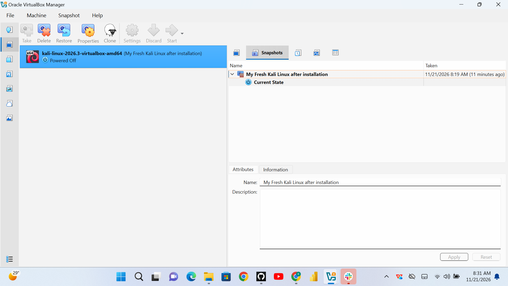

# Week 1 Project: Cybersecurity & Pentesting Lab Setup

Virtualized cybersecurity testing environment built on Windows using **Oracle VirtualBox** and **Kali Linux 2026.3** for the Networkwalks Cybersecurity program.

## Lab Specifications
- **Hypervisor:** Oracle VirtualBox
- **Guest OS:** Kali Linux 2026.3 (64-bit)
- **Network Mode:** Custom NAT Network (`NatNetwork` — `10.0.0.0/24`)
- **Static IPv4:** `10.0.0.2/24` | **Gateway:** `10.0.0.1`
- **Host Integration:** Bidirectional Shared Clipboard & Drag-and-Drop, Auto-mounted Shared Folder (`sf_Downloads`)

## Tasks Completed & Verification
1. **VirtualBox & NAT Network Setup:** Created isolated `10.0.0.0/24` subnet (`NatNetwork`).
2. **Kali Linux Import & Integration:** Enabled bidirectional clipboard/drag-and-drop and mounted host `Downloads` folder.
3. **Static IP & Connectivity Fix:** Configured static IP `10.0.0.2/24`, resolved VirtualBox 7 IPv4 DAD timeout packet drops via `nmcli`, and verified outbound HTTPS (`HTTP/2 200`).
4. **Clean Baseline Snapshot:** Created snapshot `Snapshot 1` in Powered Off state.

## Verification Screenshot

